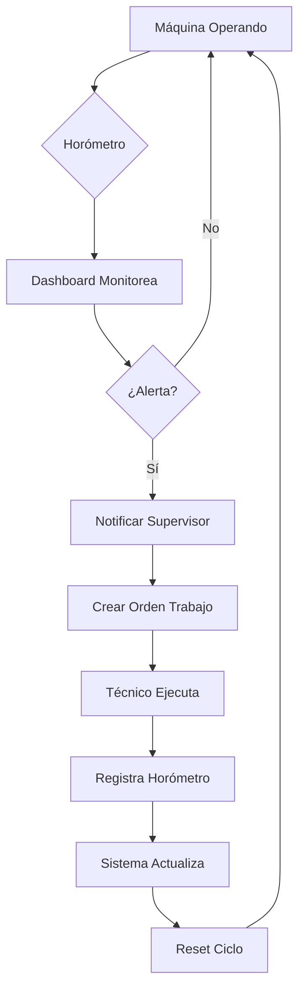

# 📊 Sistema de Control de Horómetros - Explicación Completa

## ¿Qué es el Horómetro y por qué es crítico en minería?

El **horómetro** es un contador que registra las horas de operación de una máquina. Es el equivalente al odómetro de un vehículo, pero en lugar de kilómetros, cuenta horas de trabajo.

### Importancia en Minería:
- Las máquinas mineras trabajan 24/7 en condiciones extremas
- El mantenimiento preventivo se basa en horas de uso, no en tiempo calendario
- Un mantenimiento tardío puede causar fallas catastróficas y pérdidas millonarias

## 🎯 Cómo Funciona el Sistema en el Dashboard

### 1. **Componentes del Control de Horómetros**

```
┌─────────────────────────────────────────────┐
│ Máquina: Excavadora CAT 320                │
│ Horómetro Actual: 1,500 hrs                │
│ Última Mantención: 1,250 hrs               │
│ Frecuencia: Cada 250 hrs                   │
│ Próxima Mantención: 1,500 hrs              │
│ Estado: VENCIDO ⚠️                         │
└─────────────────────────────────────────────┘
```

### 2. **Cálculo de Horas Restantes**

```php
$horas_restantes = $proxima_mantencion - $horometro_actual

Ejemplo:
- Última mantención: 1,250 hrs
- Frecuencia pauta: 250 hrs
- Próxima mantención: 1,250 + 250 = 1,500 hrs
- Horómetro actual: 1,500 hrs
- Horas restantes: 1,500 - 1,500 = 0 hrs (VENCIDO!)
```

### 3. **Barra de Progreso - Interpretación**

La barra muestra el **porcentaje de uso del ciclo de mantención**:

```
0% ████████████████████ 100%
   Verde  Amarillo  Rojo
```

- **0-79% (Verde)** ✅: Operación normal, mantención no urgente
- **80-94% (Amarillo)** ⚠️: Advertencia, programar mantención pronto
- **95-100% (Rojo)** 🔴: Crítico, mantención urgente
- **>100% (VENCIDO)** ❌: Se pasó el límite, riesgo de falla

### 4. **Estados de Alerta**

| Estado | Color | Significado | Acción Requerida |
|--------|-------|-------------|------------------|
| Normal | Verde | < 80% del ciclo | Continuar operación |
| Warning | Amarillo | 80-94% del ciclo | Programar mantención |
| Critical | Rojo | ≥ 95% del ciclo | Mantención urgente |
| VENCIDO | Rojo parpadeante | > 100% del ciclo | DETENER máquina |

## 🔄 Sistema de Actualización Automática de Horómetros

### Propuesta de Implementación:

#### 1. **Actualización Manual al Crear Orden de Trabajo**
```php
// Cuando el técnico crea una orden, registra el horómetro actual
$orden->horometro_en_ejecucion = 1520; // hrs actuales de la máquina
```

#### 2. **Actualización Automática al Completar Orden**
```php
// Al marcar la orden como "completada"
if ($orden->estado == 'completado') {
    // Actualizar horómetro de la máquina
    $maquinaria->horometro_actual = $orden->horometro_en_ejecucion;
    
    // Registrar esta mantención
    $maquinaria->ultima_mantencion_horas = $orden->horometro_en_ejecucion;
    $maquinaria->ultima_mantencion_fecha = now();
}
```

#### 3. **Actualización por Telemetría (Futuro)**
```php
// Recibir datos GPS/IoT cada hora
$telemetria = [
    'maquina_id' => 1,
    'horometro' => 1525,
    'ubicacion' => 'Mina Norte',
    'timestamp' => '2024-01-15 14:30:00'
];

// Actualizar automáticamente
$maquinaria->horometro_actual = $telemetria['horometro'];
```

#### 4. **Actualización por Integración con Sistema SCADA**
```php
// Conectar con sistemas de control industrial
$scada_data = SCADA::getMachineHours('CAT320-001');
$maquinaria->horometro_actual = $scada_data['engine_hours'];
```

## 📈 Flujo de Trabajo Propuesto



## 🚀 Mejoras Futuras Sugeridas

### 1. **Actualización en Tiempo Real**
- Instalar sensores IoT en las máquinas
- Transmisión de datos cada 15 minutos
- Dashboard actualizado automáticamente

### 2. **Predicción con IA**
- Analizar patrones de uso
- Predecir fallas antes de que ocurran
- Optimizar intervalos de mantención

### 3. **Integración con ERP**
- Conectar con SAP/Oracle
- Gestión automática de repuestos
- Costos en tiempo real

### 4. **App Móvil para Operadores**
- Registrar horómetro desde el campo
- Fotos y notas de voz
- GPS y geolocalización

## 💡 Ejemplo Práctico

**Escenario**: Camión minero Caterpillar 797F

1. **Horómetro actual**: 8,750 hrs
2. **Última mantención**: 8,500 hrs (hace 250 hrs)
3. **Frecuencia**: Cada 500 hrs
4. **Próxima mantención**: 9,000 hrs
5. **Horas restantes**: 250 hrs
6. **Porcentaje usado**: 50% (250/500)
7. **Estado**: ✅ Normal (barra verde)

**Interpretación**: 
- El camión puede operar 250 horas más
- A 10 hrs/día = 25 días aproximadamente
- Programar mantención para dentro de 3 semanas

## 🔧 Configuración Recomendada

### Para Maquinaria Crítica:
- Alerta amarilla: 85% del ciclo
- Alerta roja: 95% del ciclo
- Notificación email: 90% del ciclo
- SMS supervisor: 95% del ciclo

### Para Maquinaria Secundaria:
- Alerta amarilla: 90% del ciclo
- Alerta roja: 98% del ciclo
- Notificación email: 95% del ciclo

## 📝 Notas Importantes

1. **Nunca ignorar alertas rojas**: Riesgo de daño catastrófico
2. **Documentar siempre**: Registrar horómetro en cada inspección
3. **Calibración**: Verificar precisión del horómetro mensualmente
4. **Respaldos**: Mantener registro manual como backup

---

*Este sistema de control de horómetros es fundamental para la operación segura y eficiente de maquinaria minera, previniendo fallas costosas y maximizando la disponibilidad de los equipos.*
