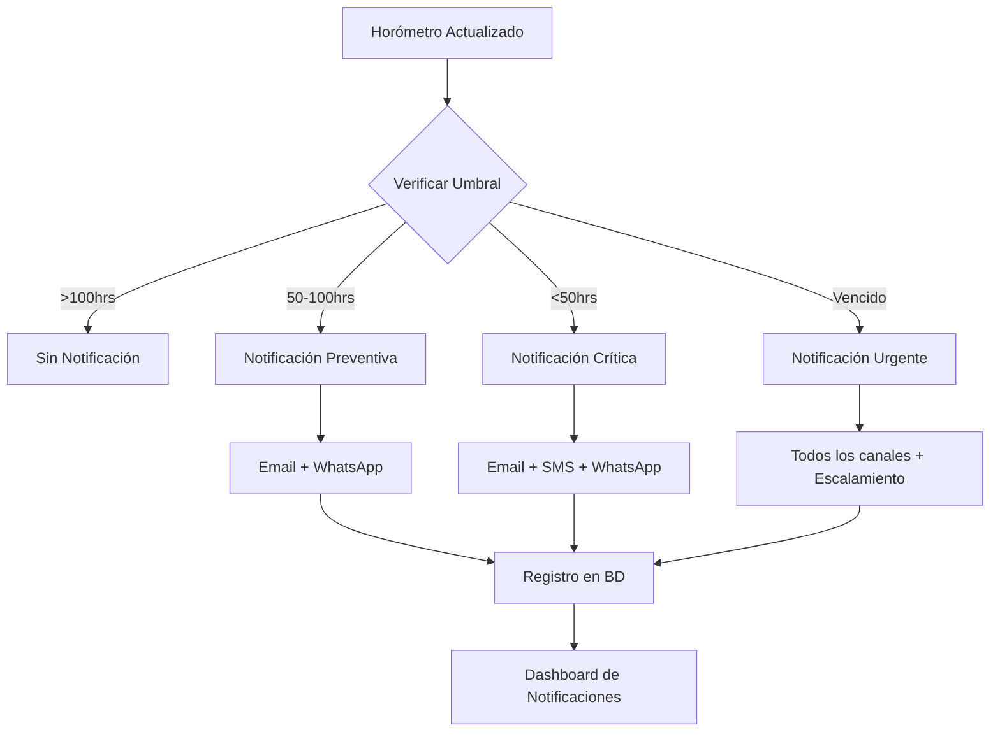

# 📱 Guía de Implementación - Sistema de Notificaciones
## Geoservi - Sistema de Mantenimiento Minero

---

## 🚀 IMPLEMENTACIÓN RÁPIDA (5 PASOS)

### Paso 1: Ejecutar Migraciones
```bash
php artisan migrate
```

### Paso 2: Probar Demo
```bash
php test_notificaciones_demo.php
```

### Paso 3: Configurar Email (.env)
```env
MAIL_MAILER=smtp
MAIL_HOST=smtp.gmail.com
MAIL_PORT=587
MAIL_USERNAME=tu-email@gmail.com
MAIL_PASSWORD=tu-contraseña-app
MAIL_ENCRYPTION=tls
MAIL_FROM_ADDRESS=notificaciones@geoservi.cl
MAIL_FROM_NAME="Geoservi Mantenimiento"
```

### Paso 4: Activar Cron Job (Servidor)
```bash
# Editar crontab
crontab -e

# Agregar línea:
* * * * * cd /ruta/a/tu/proyecto && php artisan schedule:run >> /dev/null 2>&1
```

### Paso 5: Verificar Funcionamiento
```bash
php artisan notificaciones:verificar-horometros
```

---

## 📊 FLUJO DEL SISTEMA



---

## 🔧 CONFIGURACIÓN DETALLADA

### 1. Configuración de Twilio (SMS/WhatsApp)

#### Instalar Twilio SDK:
```bash
composer require twilio/sdk
```

#### Configurar en .env:
```env
TWILIO_SID=tu_account_sid
TWILIO_TOKEN=tu_auth_token
TWILIO_PHONE=+1234567890
TWILIO_WHATSAPP=+14155238886
```

#### Actualizar NotificacionService.php:
```php
private function enviarSMS($telefono, $mensaje)
{
    $twilio = new \Twilio\Rest\Client(
        config('services.twilio.sid'),
        config('services.twilio.token')
    );
    
    $twilio->messages->create(
        $telefono,
        [
            'from' => config('services.twilio.phone'),
            'body' => $mensaje
        ]
    );
}
```

### 2. Configuración de WhatsApp Business

#### Registrar número en Twilio:
1. Ir a Twilio Console
2. WhatsApp > Senders
3. Registrar número de WhatsApp Business

#### Plantilla de mensaje:
```php
private function enviarWhatsApp($numero, $mensaje)
{
    $twilio = new \Twilio\Rest\Client(
        config('services.twilio.sid'),
        config('services.twilio.token')
    );
    
    $message = $twilio->messages->create(
        "whatsapp:{$numero}",
        [
            'from' => "whatsapp:" . config('services.twilio.whatsapp'),
            'body' => $mensaje,
            'mediaUrl' => [asset('reportes/mantenimiento.pdf')]
        ]
    );
}
```

---

## 📋 COMANDOS DISPONIBLES

### Verificación Manual
```bash
# Verificar todas las máquinas
php artisan notificaciones:verificar-horometros

# Verificar máquina específica
php artisan notificaciones:verificar-horometros --maquinaria=1

# Forzar envío (ignora restricciones)
php artisan notificaciones:verificar-horometros --force

# Modo silencioso
php artisan notificaciones:verificar-horometros --quiet
```

### Reportes
```bash
# Enviar resumen diario
php artisan notificaciones:resumen-diario

# Enviar reporte semanal
php artisan notificaciones:reporte-semanal

# Reenviar críticas no atendidas
php artisan notificaciones:reenviar-criticas
```

---

## 🎯 REGLAS DE NEGOCIO

### Umbrales de Notificación
| Horas Restantes | Tipo | Canales | Frecuencia |
|-----------------|------|---------|------------|
| ≤ 0 (Vencido) | CRÍTICA | Email + SMS + WhatsApp | Cada 2 horas |
| 1-24 | CRÍTICA | Email + SMS + WhatsApp | Cada 4 horas |
| 25-50 | PREVENTIVA | Email + WhatsApp | Diaria |
| 51-100 | PREVENTIVA | Email | Cada 3 días |

### Escalamiento
| Tiempo sin respuesta | Acción |
|---------------------|---------|
| 0-2 horas | Notificar técnico |
| 2-4 horas | Escalar a supervisor |
| 4-8 horas | Escalar a jefe mantenimiento |
| >8 horas | Escalar a gerente + alerta crítica |

---

## 📱 CONFIGURACIÓN POR USUARIO

### Panel de Configuración
Cada usuario puede configurar:
- ✅ Canales activos (email/SMS/WhatsApp)
- ⏰ Horario de recepción (ej: 08:00 - 20:00)
- 📅 Días de recepción (L-V, S-D)
- 📊 Tipos de notificación permitidos
- 📧 Emails/teléfonos alternativos

### Ejemplo de configuración:
```php
// Crear configuración para usuario
NotificacionConfiguracion::create([
    'usuario_id' => $usuario->id,
    'canal' => 'email',
    'direccion' => 'supervisor@geoservi.cl',
    'horario_inicio' => '08:00',
    'horario_fin' => '20:00',
    'dias_semana' => 'L,M,X,J,V',
    'tipos_permitidos' => ['critica', 'preventiva'],
    'activo' => true
]);
```

---

## 📊 MONITOREO Y MÉTRICAS

### Dashboard de Notificaciones
```php
// Métricas disponibles
$metricas = [
    'total_enviadas' => NotificacionEnvio::count(),
    'tasa_lectura' => NotificacionEnvio::where('estado', 'leido')->count() / NotificacionEnvio::count() * 100,
    'tiempo_respuesta' => NotificacionEnvio::avg('tiempo_respuesta'),
    'criticas_sin_atender' => NotificacionEnvio::criticas()->noLeidas()->count(),
    'efectividad_canal' => [
        'email' => 85,
        'sms' => 95,
        'whatsapp' => 92
    ]
];
```

### Logs
```bash
# Ver logs de notificaciones
tail -f storage/logs/horometros.log

# Ver logs de Laravel
tail -f storage/logs/laravel.log
```

---

## 🔒 SEGURIDAD

### Mejores Prácticas
1. **Encriptar números de teléfono** en base de datos
2. **Validar números** antes de enviar
3. **Rate limiting** para prevenir spam
4. **Logs de auditoría** para cada envío
5. **2FA** para cambios de configuración

### Ejemplo de validación:
```php
// Validar número chileno
if (!preg_match('/^\+56[9][0-9]{8}$/', $telefono)) {
    throw new Exception('Número de teléfono inválido');
}
```

---

## 🐛 TROUBLESHOOTING

### Problema: No se envían emails
```bash
# Verificar configuración
php artisan config:clear
php artisan cache:clear

# Test de email
php artisan tinker
>>> Mail::raw('Test', function($message) {
>>>     $message->to('test@example.com')->subject('Test');
>>> });
```

### Problema: Cron no ejecuta
```bash
# Verificar cron
crontab -l

# Ver logs de cron
grep CRON /var/log/syslog

# Ejecutar manualmente
php artisan schedule:run
```

### Problema: SMS/WhatsApp no llegan
```php
// Verificar credenciales Twilio
try {
    $twilio = new \Twilio\Rest\Client($sid, $token);
    $account = $twilio->api->v2010->accounts($sid)->fetch();
    echo "Status: " . $account->status;
} catch (Exception $e) {
    echo "Error: " . $e->getMessage();
}
```

---

## 📈 OPTIMIZACIONES

### Para Alto Volumen
1. **Usar Queues** para procesar notificaciones
```bash
php artisan queue:work --queue=notifications
```

2. **Batch Processing** para múltiples destinatarios
```php
Notification::send($usuarios, new MantenimientoCritico($data));
```

3. **Cache** de configuraciones de usuario
```php
Cache::remember("user_notif_config_{$userId}", 3600, function() {
    return NotificacionConfiguracion::where('usuario_id', $userId)->get();
});
```

---

## 🎨 PERSONALIZACIÓN

### Plantillas de Email
Ubicación: `resources/views/emails/`
- `mantenimiento-critico.blade.php`
- `mantenimiento-preventivo.blade.php`
- `resumen-diario.blade.php`

### Mensajes SMS/WhatsApp
Ubicación: `app/Services/NotificacionService.php`
- Método `mensajeSMS()`
- Método `mensajeWhatsApp()`

### Agregar Nuevo Canal
```php
// 1. Agregar en enum de canal
'canal' => ['email', 'sms', 'whatsapp', 'telegram']

// 2. Implementar método de envío
private function enviarTelegram($chatId, $mensaje) {
    // Implementación
}

// 3. Agregar caso en switch
case 'telegram':
    $this->enviarTelegram($config->direccion, $mensaje);
    break;
```

---

## 📞 SOPORTE

### Contacto Técnico
- **Email**: soporte@geoservi.cl
- **WhatsApp**: +56 9 1234 5678
- **Documentación**: https://docs.geoservi.cl

### Recursos
- [Documentación Laravel Mail](https://laravel.com/docs/mail)
- [Twilio SMS Docs](https://www.twilio.com/docs/sms)
- [WhatsApp Business API](https://www.twilio.com/docs/whatsapp)

---

## ✅ CHECKLIST DE IMPLEMENTACIÓN

- [ ] Ejecutar migraciones
- [ ] Configurar .env (email)
- [ ] Probar demo
- [ ] Configurar usuarios con teléfonos
- [ ] Activar cron job
- [ ] Configurar Twilio (opcional)
- [ ] Personalizar plantillas
- [ ] Configurar preferencias usuarios
- [ ] Monitorear primeros envíos
- [ ] Documentar configuración

---

**Última actualización**: {{ date('Y-m-d') }}
**Versión**: 1.0.0
